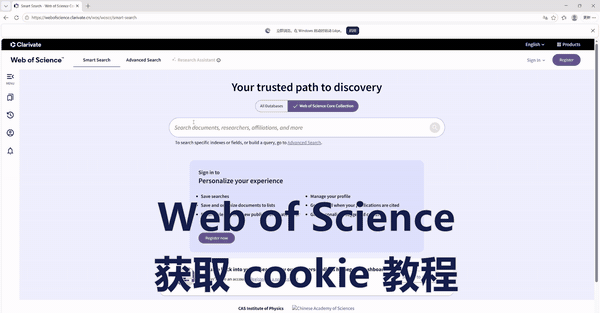

# dsh-wos-fetch

> DeepSeek Harness（DSH）的 **Web of Science 检索插件**。  
> 用 DSH 凭据库里的 WoS cookie 直连检索，返回标题/作者/来源/年/DOI/被引；完整记录落盘，不刷屏。  
> **零 Python、零第三方 npm 依赖。**

---

## 功能

- 免浏览器直连 WoS 核心合集（WoSCC），按主题/标题/作者/DOI 等字段检索。
- 返回精简 Markdown 记录表；原始 NDJSON 自动落盘，需要摘要时再按需读取。
- 设置页单独一页：录入/清除 cookie、配置数据目录、查看面向用户的说明、教程 GIF、检索习惯入口。
- 检索习惯保存在本机 Markdown 文档里，随系统提示注入；可以在对话里口述修改。
- cookie 存在 DSH 凭据库（`.credentials.yaml`，权限 0600），不写进插件包、不回显。

> ⚠️ **网络前提**：只有当前电脑的网络能正常访问 Web of Science 时，本插件才能检索。校园网/VPN 断开、或没有 WoS 订阅权限时，会返回鉴权失败。



---

## 安装

本插件是标准 DSH bundle，三种方式任选：

### 1. 在 DSH 界面里安装

侧栏 **插件 → 添加插件**，输入下面任意一种：

```
@stars-in-the-sky-42/dsh-wos-fetch
```

```
https://github.com/stars-in-the-sky-42/dsh-wos-fetch
```

```
D:\path\to\dsh-wos-fetch
```

### 2. 用命令行安装

```bash
dsh plugin --profile desktop add @stars-in-the-sky-42/dsh-wos-fetch
# 或
dsh plugin --profile desktop add https://github.com/stars-in-the-sky-42/dsh-wos-fetch
# 或本地目录
dsh plugin --profile desktop add D:\path\to\dsh-wos-fetch
```

> profile 名字按你的实际环境替换（Desktop 默认 `desktop`，Web 常用 `web`）。

安装后**重启 DSH**。侧栏设置里会出现 **文献检索（WoS）**。

---

## 首次配置

1. 打开 **设置 → 文献检索（WoS）**。
2. 在 **凭据** 里粘贴 WoS cookie：
   - Edge 打开 <https://webofscience.clarivate.cn/wos/woscc/basic-search>，确认页面正常；
   - F12 → Network → 在页面里检索一次；
   - 点任意一条 `/api/wosnx/...` 请求 → Request Headers → `cookie` → Copy value；
   - 粘进设置页，保持一整行 `name=value; name=value` 的形式；
   - 必须包含 `WOSSID`（插件拿它当 SID）。
3. 点 **保存**。状态变成“已配置”。
4. 在对话里说：`检索 Web of Science 里关于 ZrVSi 的文献，主题字段`。

> cookie 会过期。检索报 401/403 或 `needs_cookie` 时，回到设置页重新粘贴即可。

---

## 使用

```text
wos_fetch(query="ZrVSi", field="TS")
wos_fetch(query='("ScRuP" OR "ScPRu" OR "RuScP") AND superconduct*')
wos_fetch(query="Fe2P-type", count=100, page=2, sort="times-cited")
```

参数：

| 参数 | 默认 | 说明 |
|---|---|---|
| `query` | 必填 | 检索词 |
| `field` | `TS` | `TS` / `TI` / `AU` / `AI` / `SO` / `PY` / `AB` / `ALL` / `DO` / `OG` |
| `sort` | `relevance` | `relevance` / `date` / `times-cited` / `usage-count` |
| `count` | `50` | 每页条数，最大 200 |
| `page` | `1` | 第几页 |
| `max_rows` | `30` | 返回表格最多几行 |
| `save` | `true` | 是否落盘 NDJSON |

完整参数见 [docs/USAGE.md](docs/USAGE.md)。

---

## 检索习惯怎么改

**推荐方式：直接对 DSH 说。**

例如：

> 以后检索 WoS 时，先查结构、再查超导；每条结论都要带 UT/DOI；把这条记进我的检索习惯。

DSH 会调用 `wos_habits(action="write", content="...")`，把整理好的细则写进：

```
<dataDir>/habits.md
```

默认是 `$DSH_HOME/storages/wos-fetch/habits.md`；在设置页改数据目录后随之移动。本机已指向 `D:\Tool\EssayReader\data\wos\habits.md`。

- 修改后**下一条消息生效**（系统提示是动态读取的）。
- 设置页有“复制查看指令 / 复制修改示例”，也显示文件路径，方便备用。
- `wos_habits` 还支持 `read` 和 `reset`。

---

## 数据与隐私

| 数据 | 位置 |
|---|---|
| cookie | DSH 凭据库 `DSH_WOS_COOKIE`（旧文件回退：`<dataDir>/cookie.txt`） |
| NDJSON | `<dataDir>/output/` |
| 检索习惯 | `<dataDir>/habits.md` |
| apply 错误日志 | `<dataDir>/plugin-apply-error.log` |

`<dataDir>` 默认是 `$DSH_HOME/storages/wos-fetch`，可在 **设置 → 文献检索（WoS）→ 数据位置** 修改；本机已指向 `D:\Tool\EssayReader\data\wos`。

- cookie 不会出现在工具输出、日志或插件包里。
- 卸载插件不会自动删除凭据；需要时在设置页点“清除”，或手动编辑 `.credentials.yaml`。
- 详见 [docs/SECURITY.md](docs/SECURITY.md)。

---

## 常见问题

**设置页没有出现？**  
确认安装后重启了 DSH，且 profile 的 `dsh.profile.bundles` 里有本包。插件管理器里看 bundle 是否启用。

**检索报 401/403？**  
cookie 过期或与当前网络/UA 不匹配。重新复制 cookie；确认当前网络能访问 WoS。

**`needs_cookie` 一直不消失？**  
在设置页看状态是否为“已配置”；如果显示“未配置”，重新保存。旧版文件回退时，路径在错误信息里。

**会偷看我的 cookie 吗？**  
不会。cookie 只存在本机 DSH 凭据库，只发给 WoS 接口；工具输出只回报来源和长度。

**需要 Python 吗？**  
不需要。插件是纯 JavaScript，零第三方依赖。

---

## 开发

```bash
node --check index.js
node selftest.mjs          # 离线自检（不联网）
node test-client.mjs       # 设置页客户端冒烟
node scripts/verify-package.mjs
```

`assets/howto.gif` 是设置页教程动画的源文件。构建时它会被压缩并以 data URL 内嵌进 `client.js`，因此安装后不依赖 Host 静态路由，也不要求额外的 MIME 配置。

## License

MIT。基于 DeepSeek Harness 构建的社区插件，不是 DeepSeek 官方产品。
